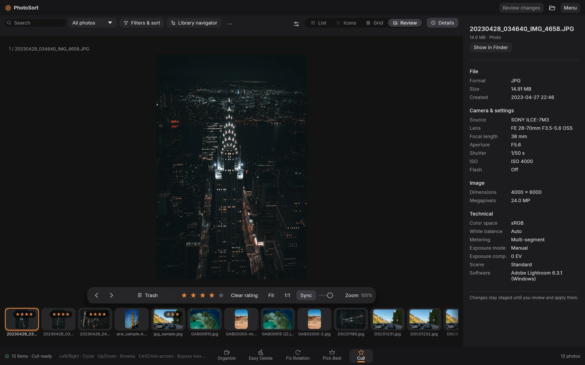
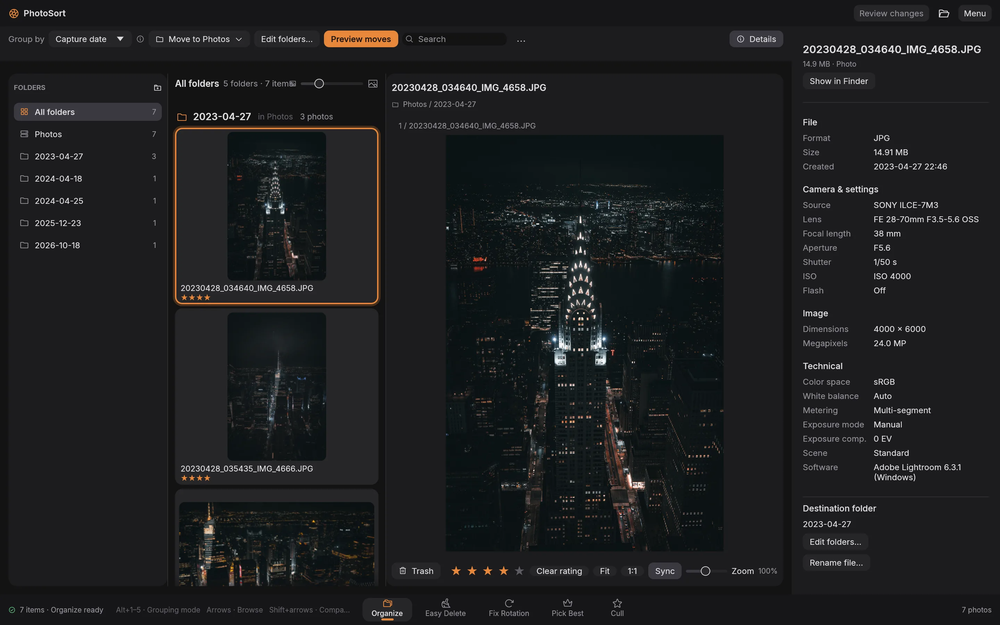
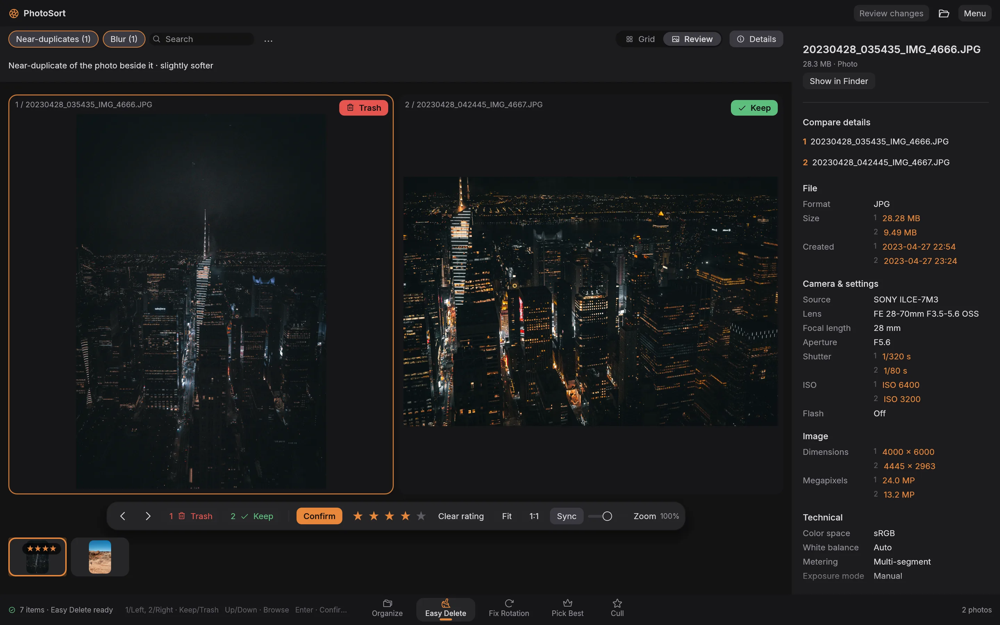
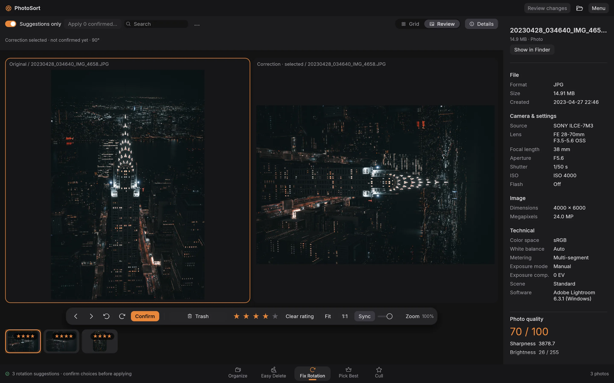
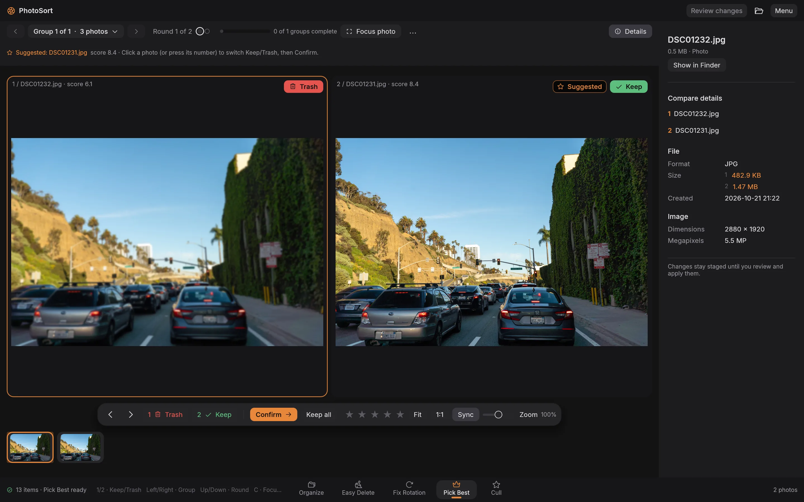
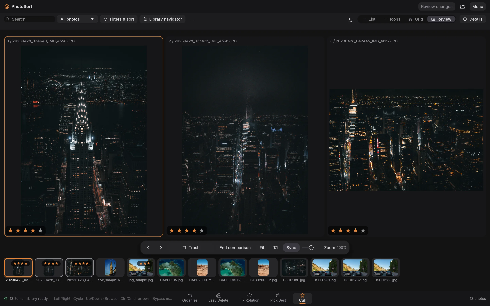

<h1 align="center">PhotoSort</h1>

<p align="center">
  <strong>Choose which photos to keep before you start editing.</strong>
</p>

<p align="center">
  <a href="https://github.com/duartebarbosadev/PhotoSort/actions/workflows/check.yml"></a>
  <a href="LICENSE"></a>
  <a href="#build-from-source"></a>
</p>

PhotoSort helps you go from a folder full of new photos to the ones worth keeping. It finds
blurry shots and duplicates, puts similar photos side by side so you can pick the best, fixes
sideways photos and sorts everything into folders. Nothing on disk changes until you review
the exact list of moves and deletions, and everything runs on your computer: no photo is ever
uploaded.

> [!WARNING]
> PhotoSort moves, renames and deletes your photos. **Back up your photos before you use
> it**, and keep that backup until you have checked the result. See
> [Keep your photos safe](#keep-your-photos-safe).

[](assets/screenshots/cull.webp)

PhotoSort 3 is a native rewrite; the Python version is at the
[`python-final`](https://github.com/duartebarbosadev/PhotoSort/tree/python-final) tag.

## Download

PhotoSort 3 has no release yet, so [build it from source](#build-from-source). Its releases
will include an app for Apple Silicon Macs and a zip for Windows x64.

PhotoSort opens JPEG, PNG, TIFF, WebP, HEIC and most camera RAW formats, and plays common
video formats. Ratings and rotations go into the photo's metadata or an XMP sidecar, so
Lightroom and other editors see them.

## Five steps

The steps sit along the bottom of the window. Use only the ones you need, in any order.
PhotoSort remembers where you left off in each folder. **Menu → Watch the intro** shows a
30-second tour.

| Step | What it's for |
| --- | --- |
| **Organize** | Sort a messy import into folders. |
| **Easy Delete** | Clear out duplicates, blurry shots and bad exposures. |
| **Fix Rotation** | Straighten sideways and upside-down photos. |
| **Pick Best** | Keep the best shot from each burst. |
| **Cull** | Go through everything yourself and decide what stays. |

### Organize

Sort photos into folders by date, place, camera, people or similar scenes. Drag photos
between folders and rename folders in place. RAW + JPEG pairs and their sidecars move
together.

[](assets/screenshots/organize.webp)

### Easy Delete

PhotoSort finds exact and near duplicates, JPEG and HEIC copies of the same shot, blurry
shots and bad exposures, and shows each next to its better match. Its suggestions start as
your choices: change only the ones you disagree with.

[](assets/screenshots/easy-delete.webp)

### Fix Rotation

Compare each sideways or upside-down photo with the suggested correction, then confirm it or
turn the photo yourself. Rotations are saved without re-compressing the photo.

[](assets/screenshots/fix-rotation.webp)

### Pick Best

PhotoSort shows a burst two shots at a time and suggests the sharper, better composed one
with everyone's eyes open, until one winner is left. You make every final call, and you can
keep more than one.

[](assets/screenshots/pick-best.webp)

### Cull

Scan the folder as a grid, open a photo full screen, or compare up to nine similar shots side
by side with shared zoom. Rate your favorites, mark the rest for Trash, and filter by rating
or by group of similar shots.

[](assets/screenshots/cull-compare.webp)

### Nothing changes until you say so

Marks, ratings and folder plans stay staged while you work. **Review changes** (Shift+Enter)
lists every move, rename, rating and file sent to Trash before anything happens. If PhotoSort
stops halfway, reopen the folder to finish the rest.

## Keep your photos safe

PhotoSort changes the files in the folder you open. Treat it like any tool that edits your
library:

- **Back up first.** Copy the folder to another drive, or check that your backup (Time
  Machine, File History, a NAS or cloud backup) is current before you apply changes.
- **Work on a copy of new imports.** Keep the photos on the memory card until you have sorted
  them and backed up the result.
- **Read the review list.** Check every move and deletion in **Review changes** first.
- **Empty the Trash later.** Deleted photos go to the system Trash (Recycle Bin on Windows).
  Keep them there until you are sure.
- **Leave originals untouched.** **Settings → Save changes to → Sidecars only** writes
  ratings and rotations to XMP sidecars instead of the photo files.

## Useful shortcuts

Each step shows its keys in the status bar. **Menu → Keyboard guide** has the full list.

| What you want to do | Shortcut |
| --- | --- |
| Open a folder | Ctrl/Cmd+O |
| Switch step | Ctrl/Cmd+Alt+1–5 |
| Run this step's analysis | Ctrl/Cmd+S |
| Keep / trash the shown photo (Easy Delete, Pick Best) | 1 / 2 |
| Move to the next or previous photo (Cull) | Left / Right |
| Mark or unmark for Trash (Cull) | D |
| Rate, or clear the rating with 0 | Ctrl/Cmd+0–5 |
| Show one photo or compare side by side | F1 |
| Review and apply your changes | Shift+Enter |

## Local AI

All analysis runs on your computer, with no account. Every step also works by hand.

- **Similar shots** (Organize, Easy Delete, Pick Best, Cull): Meta's DINOv2.
- **Faces and closed eyes** (Organize, Easy Delete, Pick Best): MediaPipe face models, and
  OpenCV's SFace to recognize the same person across photos.
- **Best shot** (Pick Best): an aesthetic model, combined with sharpness and open eyes.
- **Rotation** (Fix Rotation): [deep-image-orientation-detection](https://github.com/duartebarbosadev/deep-image-orientation-detection).
- Blur, exposure and exact duplicates use plain image measurements, not AI.

**Menu → AI models** downloads and verifies the models; nothing downloads on its own. Macs
use Apple Core ML. Windows and Linux use the CPU unless you change **Settings → Performance →
Run AI on**.

## Build from source

You need [Rust](https://rustup.rs) 1.95 or later and the native libraries listed in
[CONTRIBUTING.md](CONTRIBUTING.md#building) for macOS, Windows and Linux. Then run:

```sh
cargo run --release -- --folder /path/to/photos
```

CI builds and tests all three platforms. Desktop use on Linux is not verified.

### Built with

| Component | Used for | Version |
| --- | --- | --- |
| [Rust](https://www.rust-lang.org) and [egui](https://github.com/emilk/egui) | The app and its interface | Rust 1.95+, egui 0.36 |
| [ONNX Runtime](https://onnxruntime.ai) | Local AI on the CPU, Apple Core ML or NVIDIA CUDA | 1.29.0 |
| [libvips](https://www.libvips.org) and [Little CMS](https://www.littlecms.com) | JPEG, PNG, TIFF and GIF photos, color management | 8.18+, 2.16+ |
| [LibRaw](https://www.libraw.org) | RAW photos | 0.21+ |
| [Exiv2](https://exiv2.org) | Ratings, rotation and other metadata inside photos | 0.28+ |
| [libheif](https://github.com/strukturag/libheif) | HEIC photos on Windows and Linux (macOS uses its own) | 1.23+ |
| [GStreamer](https://gstreamer.freedesktop.org) | Video on Windows and Linux (macOS uses AVFoundation) | 1.20+ |

## Questions or feedback?

[Open an issue](https://github.com/duartebarbosadev/PhotoSort/issues). For bugs, include your
PhotoSort version, operating system, the file formats involved and the steps that led there.

## License

The source code is licensed under the [Apache License 2.0](LICENSE). Released app binaries
link Exiv2 (GPL-2.0-or-later), so they are distributed under the GNU GPL, version 3.
Third-party components keep their own terms: see [resources/ASSETS.md](resources/ASSETS.md)
and [resources/licenses/](resources/licenses/).
