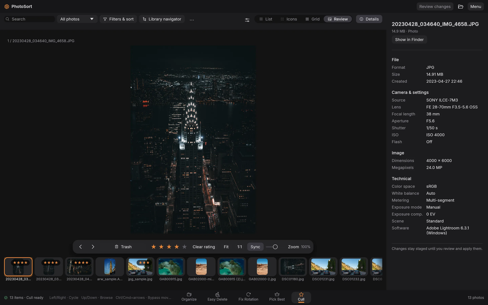
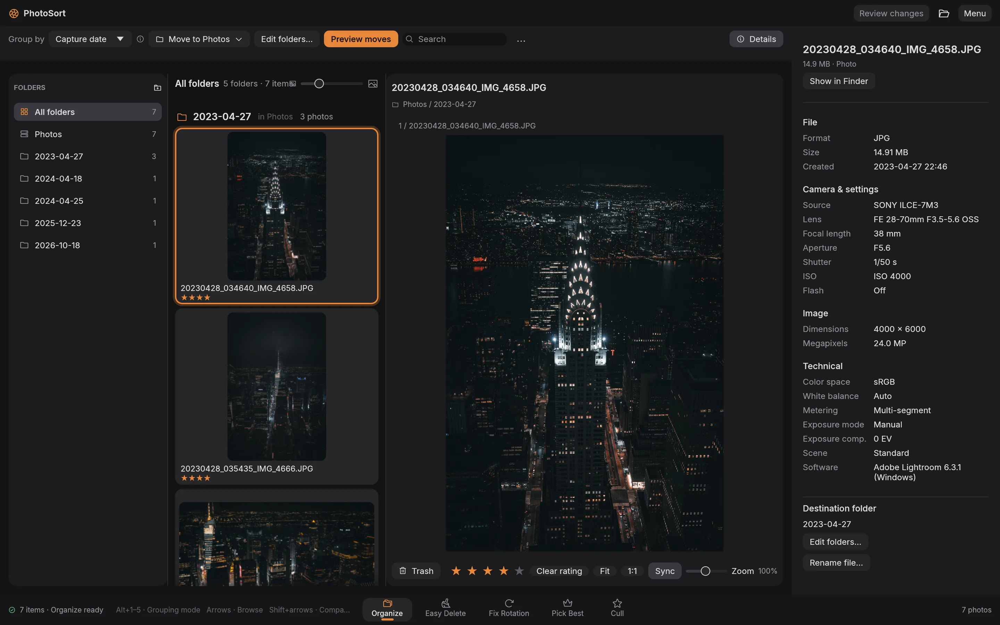
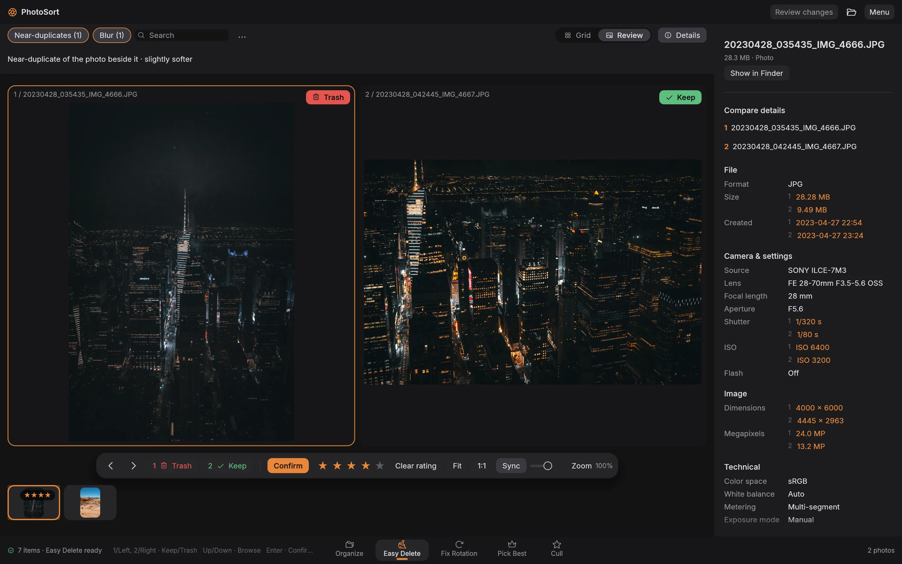
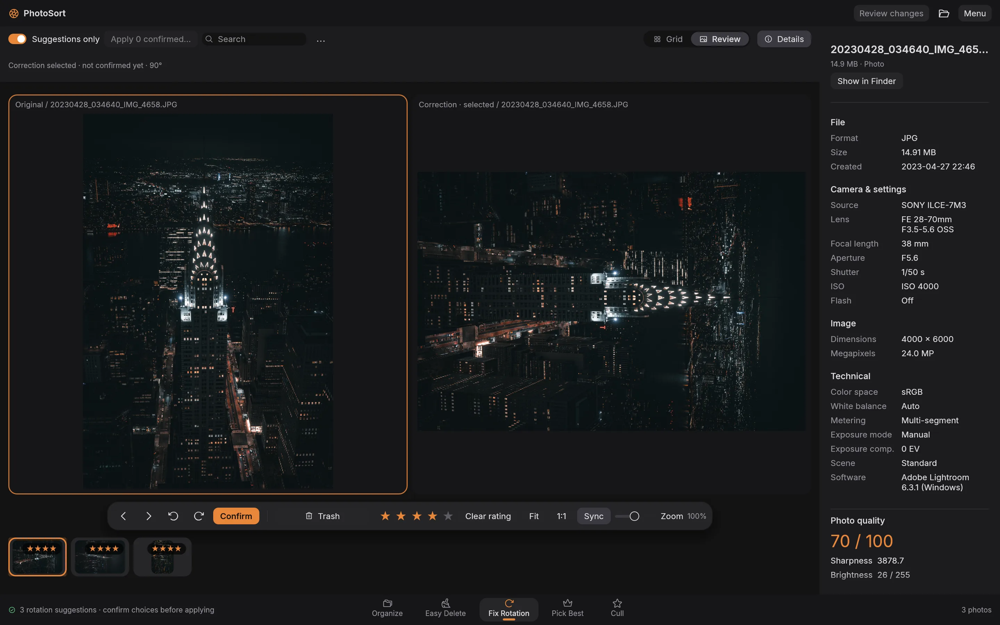
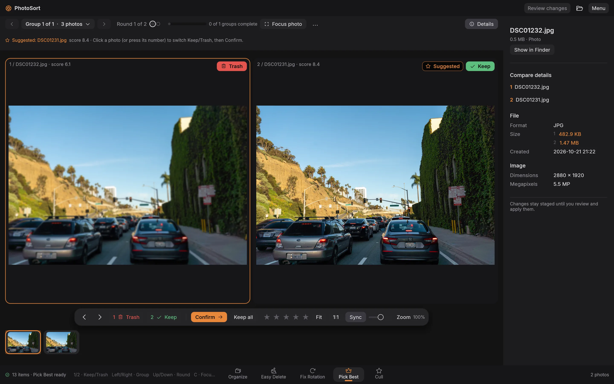
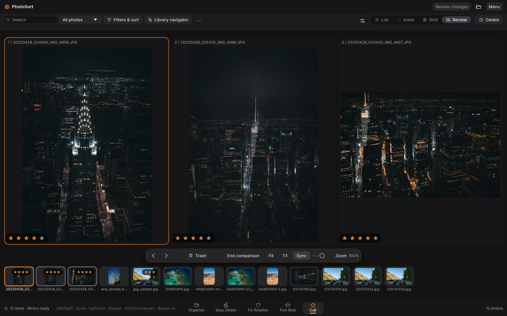

<h1 align="center">PhotoSort</h1>

<p align="center">
  <strong>Choose which photos to keep before you start editing.</strong>
</p>

<p align="center">
  <a href="https://github.com/duartebarbosadev/PhotoSort/actions/workflows/check.yml"></a>
  <a href="LICENSE"></a>
</p>

PhotoSort helps you go from a folder full of new photos to the ones worth keeping. It finds
blurry shots and duplicates, puts similar photos side by side so you can pick the best, fixes
sideways photos and sorts everything into folders. Nothing on disk changes until you review
the exact list of moves and deletions, and everything runs on your computer: no photo is ever
uploaded.

[](assets/screenshots/cull.webp)

<p align="center">
  <a href="#download">Download</a> ·
  <a href="#five-steps">Five steps</a> ·
  <a href="#useful-shortcuts">Shortcuts</a> ·
  <a href="#local-ai">Local AI</a> ·
  <a href="#build-from-source">Build from source</a>
</p>

> PhotoSort 3 is a native rewrite. The previous Python version stays available at the
> [`python-final`](https://github.com/duartebarbosadev/PhotoSort/tree/python-final) tag and in
> [releases](https://github.com/duartebarbosadev/PhotoSort/releases) up to v2.1.0.

## Download

Releases are published on the [Releases page](https://github.com/duartebarbosadev/PhotoSort/releases).
The first native release (3.0) is on its way; until then, [build from source](#build-from-source).

PhotoSort opens JPEG, PNG, TIFF, WebP, HEIC and the RAW formats of most cameras, and plays
common video formats. Star ratings and rotations are saved into the photo's own metadata, or
into XMP sidecars, so they carry over to Lightroom and other editors.

## Five steps

The steps sit along the bottom of the window. Use only the ones you need, in any order.
PhotoSort remembers where you left off in each folder. The first launch plays a 30-second
intro to the steps; **Menu → Watch the intro** plays it again.

| Step | What it's for |
| --- | --- |
| **Organize** | Sort a messy import into folders. |
| **Easy Delete** | Clear out duplicates, blurry shots and bad exposures. |
| **Fix Rotation** | Straighten sideways and upside-down photos. |
| **Pick Best** | Keep the best shot from each burst. |
| **Cull** | Go through everything yourself and decide what stays. |

### Organize

Turn a camera dump into folders by date, place, camera, people or similar scenes. Drag
photos between folders, rename folders in place, and check where every file will go before
anything moves. RAW + JPEG pairs and their sidecars always move together.

[](assets/screenshots/organize.webp)

### Easy Delete

Get rid of the obvious rejects first. PhotoSort finds exact and near duplicates, blurry
shots and photos that are too dark or too bright, and shows each one next to its better
match. Keep or trash each with one key, or accept all the suggestions at once.

[](assets/screenshots/easy-delete.webp)

### Fix Rotation

Find photos that are sideways or upside down. Compare the original with the suggested
correction, confirm it or turn the photo yourself. Rotations are saved without
re-compressing the photo.

[](assets/screenshots/fix-rotation.webp)

### Pick Best

Took ten shots of the same moment? PhotoSort shows them two at a time, suggests the one
that is sharper, better composed and has everyone's eyes open, and keeps going until one
winner is left. You make every final call, and you can keep more than one.

[](assets/screenshots/pick-best.webp)

### Cull

Go through your photos at your own pace. Scan the whole folder as a grid to see what you
have, open a photo full screen to judge it, or put up to nine similar shots side by side and
zoom into all of them at once to compare focus and expressions. Give your favorites stars,
mark the rest for Trash, and filter by rating or by group of similar shots to work through
one moment at a time.

[](assets/screenshots/cull-compare.webp)

### Nothing changes until you say so

Marks, ratings and folder plans stay staged while you work. **Review changes**
(Shift+Enter) lists every move, rename, rating and file sent to Trash before anything
happens. If PhotoSort is interrupted halfway, reopen the folder to finish or retry the rest;
finished changes are never repeated.

## Useful shortcuts

Each step shows its keys in the status bar, and **Menu → Keyboard guide** has the full list.

| What you want to do | Shortcut |
| --- | --- |
| Open a folder | Ctrl/Cmd+O |
| Switch step | Ctrl/Cmd+Alt+1–5 |
| Run this step's analysis | Ctrl/Cmd+S |
| Keep / trash the shown photo (Easy Delete, Pick Best) | 1 / 2 |
| Move to the next or previous photo (Cull) | Left / Right |
| Mark or unmark for Trash (Cull) | D |
| Rate, or clear the rating with 0 | Ctrl/Cmd+0–5 |
| Show one photo or compare side by side | F1 |
| Review and apply your changes | Shift+Enter |

## Local AI

All analysis runs **on your computer**. No photos or data are sent anywhere, and no account
is needed. You can also use every step by hand, without AI.

- **Similar shots** (Organize, Easy Delete, Pick Best, Cull): Meta's DINOv2 groups photos of
  the same scene or subject.
- **Faces and closed eyes** (Organize, Easy Delete, Pick Best): MediaPipe face models, plus
  OpenCV's SFace to recognize the same person across photos.
- **Best shot** (Pick Best): an aesthetic model scores composition and lighting, combined
  with sharpness and open eyes.
- **Rotation** (Fix Rotation): [deep-image-orientation-detection](https://github.com/duartebarbosadev/deep-image-orientation-detection)
  spots sideways and upside-down photos.
- Blur, exposure and exact-duplicate checks use plain image measurements, not AI.

**Menu → AI models** shows which models are installed and downloads or imports the missing
ones, verifying every file. Nothing is downloaded automatically. Models run on the CPU by
default; on a Mac, Settings can switch them to Apple's Core ML acceleration.

## Build from source

You need [Rust](https://rustup.rs) 1.95 or later. On macOS, install the native libraries
with Homebrew, then build and open a folder:

```sh
brew install libraw exiv2 pkg-config
```

```sh
cargo run --release -- --folder /path/to/photos
```

To build a standalone `PhotoSort.app`:

```sh
python3 scripts/package_macos.py
```

Linux and Windows instructions, the AI runtime setup, command-line options and everything
else for developers are in [CONTRIBUTING.md](CONTRIBUTING.md).

| Platform | Status |
| --- | --- |
| macOS | Supported and tested in CI |
| Linux | Builds and passes tests in CI; desktop use not yet verified |
| Windows | Builds and passes tests in CI; the full build and desktop use are not yet verified |

## Questions or feedback?

[Open an issue](https://github.com/duartebarbosadev/PhotoSort/issues) if something isn't
working, a step is confusing, or you'd like a feature. For bugs, include your PhotoSort
version, operating system, the file formats involved and what you did before the problem
happened.

## License

PhotoSort's source code is licensed under the Apache License 2.0 ([LICENSE](LICENSE)).
Because PhotoSort links Exiv2 (GPL-2.0-or-later), released app binaries are distributed under
the terms of the GNU General Public License, version 3. Third-party components keep their own
terms: LibRaw (LGPL-2.1 or CDDL-1.0), the aesthetic model (AGPL-3.0), ONNX Runtime (MIT),
GeoNames location data (CC BY 4.0) and the Inter font (SIL OFL 1.1). See
[resources/ASSETS.md](resources/ASSETS.md) for provenance and
[resources/licenses/](resources/licenses/) for license texts.
